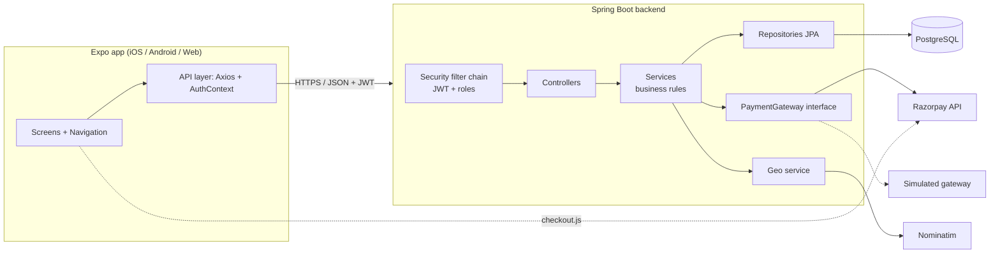
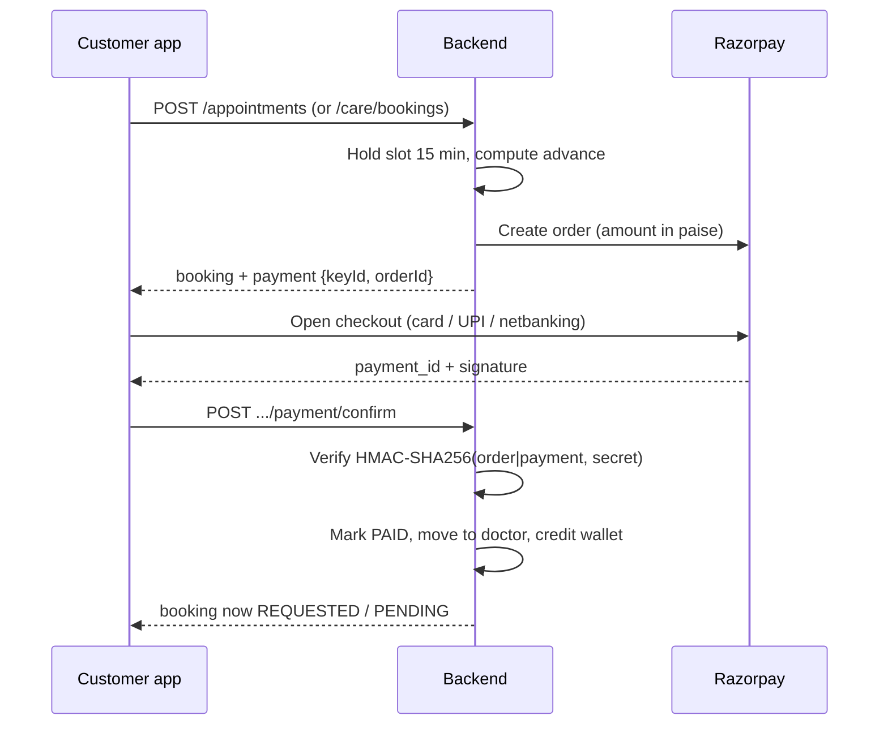
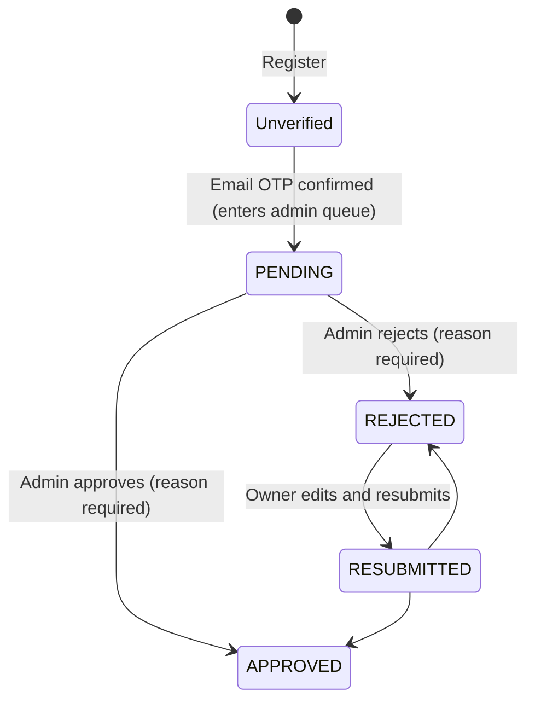

# VetConnect: Project Documentation

A mobile and web app where pet owners find verified veterinarians, book appointments with an advance payment, and book pet-care services (grooming, boarding, training). Doctors and pet-care businesses manage their schedules, requests and earnings; admins verify who is allowed on the platform.

- **Backend:** Java 21, Spring Boot 3.3, PostgreSQL, Flyway
- **App:** Expo (React Native 0.88, TypeScript) running on iOS, Android and the web
- **Payments:** Razorpay (or a built-in test gateway)

---

## 1. Who uses it (roles)

| Role | What they do |
|---|---|
| **Pet owner (customer)** | Registers with a location, adds pets, finds doctors and pet-care businesses **near them**, books, pays the advance, reschedules, cancels, reviews. |
| **Veterinarian (doctor)** | Registers with a pinned clinic location and payment details, is approved by an admin, sets availability, accepts or rejects requests, approves reschedules, writes consultation notes and prescriptions, sees the **wallet**. Can also offer pet care from the same clinic. |
| **Pet-care business (provider)** | Registers with services, hours, capacity and payment details, is approved by an admin, manages a price menu and booking requests, has a **wallet**. |
| **Admin** | Reviews new applications and re-approval requests (with a mandatory written reason), sees platform statistics. |

---

## 2. Features

### Accounts and security
- Register and log in with a **mobile number** (international form, unique per account) plus password; an email is optional. Registration is confirmed with a **6-digit OTP** sent to the mobile number (10 minutes, stored hashed, 5 tries, resend every 30 s). Unverified accounts cannot log in and **do not appear in the admin queue**. Older accounts can still sign in with their email.
- Confirm-password field, number validation with country code.
- JWT access and refresh tokens, BCrypt password hashing, **forgot / reset password** by mobile number with a one-time code (hashed, 30 minutes, locks after 5 wrong tries, signs the user out everywhere).
- Role-based access on every endpoint.

### Location
- **Country → State → District/City** dropdowns (250 countries, about 5,000 states, about 148,000 districts, bundled in the backend), postal/PIN-code lookup, GPS, and a **map pin** (OpenStreetMap, no API key).
- Customers only see doctors and businesses in reach: by distance (default 25 km, up to 100 km) when both sides have a pin, otherwise by matching district/city (and country/state when known).
- Clinics and businesses must **pin their exact spot**; customers get a map and a **Get Directions** button.

### Vet appointments
- Book a slot; **50% of the consultation fee is paid as an advance** (the rest at the clinic). The slot is **held for 15 minutes** while paying, then released.
- The doctor sees a request only after the advance is paid, and accepts or rejects it.
- **My day (slots)**: a doctor sees every slot of any date (booked by customers, free, break) and can block free slots themselves and undo only those; customer-booked slots are locked.
- **Reschedule is a request**: the appointment keeps its time until the doctor approves; the doctor can decline with a reason; the owner can withdraw.
- **Refund rules:** doctor rejects or cancels = full refund; customer cancels 24 h or more before = full refund; later = advance kept. The app states the outcome before the customer confirms.
- Consultation notes, prescriptions, medical history per pet, reviews that update the doctor's rating, in-app notifications.

### Pet care (grooming, boarding, training)
- Businesses build a menu: prices by **pet size** (small ≤ 7 kg, medium ≤ 20, large ≤ 35, giant), per session or **per night** for boarding, and flat add-ons.
- Opening hours, slot length, parallel capacity, boarding places; advance percentage (default 30%).
- Booking with capacity checks, the same hold, advance, refund and review model as vet appointments.

### Money
- **Advance payments** through Razorpay Standard Checkout (UPI, cards, net banking, wallets) or a simulated test gateway.
- **Wallet** for doctors and businesses: every advance paid for them is credited, every refund is debited, with a full history. (It is a ledger: nothing is paid out to a bank from it yet.)
- **Payment details are mandatory** for doctors and businesses (UPI id or bank account); account numbers are shown masked.

### Admin
- Separate queues for **new applications** and **re-approval requests** (doctors and pet-care businesses). Approve or reject always needs a reason, shown to the applicant, who can edit and resubmit.

---

## 3. Technology stack

### Backend
| Concern | Technology |
|---|---|
| Language / runtime | Java 21 |
| Framework | Spring Boot 3.3.4 (Web, Data JPA, Validation, Security, Scheduling) |
| Database | PostgreSQL 16 (H2 in memory for unit tests) |
| Migrations | Flyway (V1 to V12) |
| Authentication | JWT (jjwt) with refresh tokens, Spring Security |
| API docs | springdoc OpenAPI / Swagger UI at `/swagger-ui.html` |
| Boilerplate | Lombok |
| HTTP client | Spring `RestClient` (Razorpay, OpenStreetMap Nominatim) |
| Build | Maven (wrapper included) |
| Tests | JUnit 5, Mockito, Spring Test (197 tests) |
| Packaging | Dockerfile, `docker-compose.yml` (Postgres + backend) |

### App (frontend)
| Concern | Technology |
|---|---|
| Framework | Expo SDK 58, React Native 0.88, React 19 |
| Language | TypeScript |
| Navigation | React Navigation (native stacks + bottom tabs) |
| UI kit | React Native Paper (theme) plus custom components |
| HTTP | Axios with token-refresh interceptor |
| Forms / validation | Own validators (email, password, payout rules); react-hook-form and zod are installed |
| Storage | expo-secure-store (tokens), web fallback |
| Maps | Leaflet + OpenStreetMap inside a WebView (iframe on web) |
| Location | expo-location, OpenStreetMap Nominatim through the backend |
| Payments UI | Razorpay `checkout.js` inside a WebView (modal overlay on web) |
| Web | react-native-web, @expo/metro-runtime |
| Icons | @expo/vector-icons (Ionicons) |

### External services
- **Razorpay**: orders, checkout, signature verification, refunds.
- **OpenStreetMap Nominatim**: postal-code and reverse lookups, proxied, cached and rate-limited by the backend.
- **OpenStreetMap tiles** (via Leaflet) for maps.
- No email or SMS provider yet: OTP and reset codes are written to the server log as `[SIMULATED EMAIL] ...`.

---

## 4. Architecture

### 4.1 System overview



### 4.2 Backend layers

A conventional layered Spring Boot app. Each request flows `Filter → Controller → Service → Repository → Database`.

```
backend/src/main/java/com/vetconnect/
├── VetConnectApplication.java
├── config/        Security, JWT filter, CORS, request logging, OpenAPI, properties, Clock, demo-data seeder
├── common/        ApiResponse, PageResponse, GlobalExceptionHandler, exceptions, security helpers,
│                  LocationMatch + GeoUtils (distance / area rules), PayoutRules (UPI, bank, IFSC)
├── controller/    REST endpoints (14 controllers, about 110 routes)
├── dto/           Request and response objects, grouped per area (auth, care, appointment, wallet...)
├── domain/
│   ├── entities/  JPA entities (23)
│   └── enums/     Role, AppointmentStatus, CareBookingStatus, PaymentStatus, VerificationStatus, ...
├── repository/    Spring Data JPA repositories (20)
├── service/       Business logic (15 services)
├── payment/       PaymentGateway interface + Razorpay and Simulated implementations
└── geo/           GeoService, Nominatim client, bundled world dataset loader
```

Key design points:
- **Controllers are thin**: validation (`@Valid`), role checks (`@PreAuthorize`) and mapping. Rules live in services.
- **Uniform responses**: `ApiResponse { success, message, data, timestamp }` and `PageResponse` for lists; `GlobalExceptionHandler` maps exceptions to HTTP codes (400, 401, 403, 404, 409).
- **Transactions**: services are `@Transactional`; flows that must keep a counter or a refund after an expected failure use `noRollbackFor = BadRequestException`.
- **Concurrency**: pet-care capacity uses a pessimistic row lock on the provider; appointments are locked when paid or answered; a partial unique index (`idx_unique_active_doctor_slot`) makes double booking impossible at the database level.
- **Time**: one injectable `Clock` bean so time-based rules (holds, 24-hour refunds) are testable.
- **Scheduled jobs**: every minute, unpaid holds expire (appointments and pet-care bookings) and free their slot.
- **Logging**: `RequestLoggingFilter` logs one line per request (method, path, status, time, user, IP) to `backend/logs/vetconnect.log` (rolling, 14 days). Bodies and passwords are never logged.

### 4.3 Payment architecture



- `PaymentGateway` is the single seam (`name`, `publicKey`, `createOrder`, `verifySignature`, `refund`). Switching is a config value: `PAYMENT_GATEWAY=simulated` (default, test buttons, no money) or `razorpay`.
- **A payment counts only after its signature is verified** with the secret key; forged or replayed results are refused. The secret never leaves the server.
- Refunds go through Razorpay's refund API and are debited from the recipient's wallet.
- A payment that arrives after the hold expired is refunded automatically.
- `care_payments` holds the advance for either a pet-care booking or a vet appointment.

### 4.4 Wallet

`wallet_transactions` is an append-only ledger per user: `CREDIT` when an advance is paid (once per payment, enforced by a partial unique index), `DEBIT` when part or all is refunded. Balance = credits minus debits. It is a record of what a doctor or business is owed; there is no payout automation.

### 4.5 Approval and verification flow



Pet-care businesses additionally cannot be approved, shown or booked without payment details.

### 4.6 Booking state machines

- **Vet appointment:** `AWAITING_PAYMENT → PENDING → CONFIRMED → COMPLETED`; or `CANCELLED`, `REJECTED`, `EXPIRED`, `NO_SHOW`.
- **Pet-care booking:** `AWAITING_PAYMENT → REQUESTED → CONFIRMED → COMPLETED`; or `CANCELLED`, `REJECTED`, `EXPIRED`.

---

## 5. Data model

Managed by Flyway migrations (`backend/src/main/resources/db/migration`); Hibernate only **validates** the schema.

| Group | Tables |
|---|---|
| Identity | `users`, `refresh_tokens`, `email_verification_otps`, `password_reset_tokens` |
| Profiles | `customer_profiles`, `doctor_profiles`, `specializations` (+ join), `doctor_availabilities`, `doctor_verification_documents` |
| Pets and care records | `pets`, `medical_records`, `prescriptions` |
| Vet appointments | `appointments` (advance, hold, reschedule-request columns), `reviews` |
| Pet care | `provider_profiles` (+ categories), `provider_hours`, `care_services`, `care_bookings`, `care_booking_items`, `care_reviews` |
| Money | `care_payments` (appointment **or** booking), `wallet_transactions` |
| Other | `notifications` |

Migration history (V13 and V14 make mobile numbers unique and fix older numbers): V1 schema, V2 demo data, V3 reset tokens, V4 to V5 data fixes, V6 location/OTP/review reasons, V7 country/state, V8 pet care + payments, V9 clinic advance payments, V10 reschedule requests, V11 provider payout details, V12 doctor payout details + wallet (with backfill), V13 mobile-number login (normalised, unique), V14 fix for ten-digit Indian numbers, V15 doctor-blocked slots.

---

## 6. API overview

Base path `/api`. Interactive docs: `http://localhost:8080/swagger-ui.html`.

| Area | Prefix | Examples |
|---|---|---|
| Auth | `/auth` | `register`, `verify-otp`, `resend-otp`, `login`, `refresh`, `forgot-password`, `reset-password` |
| Geo | `/geo` | countries, states, districts, postal-code lookup, reverse lookup |
| Customers / pets | `/customers`, `/pets`, `/pets/{id}/medical-records` | profile, pets CRUD, medical history |
| Doctors | `/doctors` | search (location-aware), details, `profile/me`, availability, resubmit |
| Doctor day view | `/doctors/me/schedule`, `/doctors/me/blocked-slots` | slots with status, block a free slot, undo my own block |
| Appointments | `/appointments` | book, my, confirm, reject, cancel, complete, **reschedule** (+ approve/reject/withdraw), **payment** (simulate / confirm / failed / retry), cancellation-preview |
| Reviews | `/doctors/{id}/reviews` | list, create |
| Pet care (customer) | `/care` | `config`, providers search, slots, boarding availability, bookings, payment, cancel, review |
| Pet care (business) | `/provider` | profile, hours, services CRUD, bookings (accept / reject / cancel / complete), resubmit |
| Wallet | `/wallet` | balance and transactions (doctor or provider only) |
| Notifications | `/notifications` | list, mark read |
| Admin | `/admin` | dashboard, pending / resubmitted doctors and providers, verification decisions, all appointments |

Security rules are in `SecurityConfig`: public auth, geo, specializations and care config; everything else needs a valid JWT, with `@PreAuthorize` per route (customer, doctor, provider, admin).

---

## 7. App (frontend) architecture

```
frontend/
├── App.tsx            Providers (Safe area, Paper theme, Auth), loads server config (currency, gateway, advance %)
└── src/
    ├── api/           One module per backend area (authApi, doctorApi, careApi, walletApi...) + client.ts
    ├── context/       AuthContext: session, login, register, OTP, logout, token refresh
    ├── navigation/    RootNavigator picks a navigator by role:
    │                  Auth / Customer (tabs + stack) / Doctor (tabs + stack) / Provider (stack) / Admin
    ├── screens/       auth, customer, doctor, provider, admin, shared (wallet)
    ├── components/    common (inputs, buttons, maps, location picker, keyboard handling),
    │                  appointment, care, doctor, pet, payment (Razorpay checkout, pay panel, wallet card)
    ├── theme/         Colour palette (sky blue, white, ink), shared styles, bottom-tab bar style
    └── utils/         helpers (money, errors, dates, currency from server), validators, maps/directions
```

Design points:
- **Role-based navigation**: the logged-in role decides which navigator renders (`RootNavigator`).
- **API client** (`client.ts`) finds the backend automatically from the Metro host, attaches the JWT, and refreshes it on a 401.
- **Server-driven config**: currency symbol, payment gateway and clinic advance percent come from `GET /api/care/config`, so prices show in the right currency.
- **Cross-platform helpers** (confirm/alert dialogs, date field, map) have web and native variants.
- **Keyboard handling**: `KeyboardScroll` / `KeyboardAvoid` wrappers keep inputs visible on every form.
- **Design**: sky-blue and white with ink-black pill buttons, a dark rounded bottom bar, and a launcher-style home screen (icon grid, Explore cards, Upcoming).

---

## 8. Configuration

Backend settings in `application.yml`, overridable by environment variables (see `.env.example`):

| Variable | Purpose | Default |
|---|---|---|
| `DB_HOST`, `DB_PORT`, `DB_NAME`, `DB_USER`, `DB_PASSWORD` | PostgreSQL | localhost, 5432, vetconnect, postgres, postgres |
| `SERVER_PORT` | Backend port | 8080 |
| `JWT_SECRET`, `JWT_EXPIRATION_MS` | Token signing and lifetime | demo secret, 24 h |
| `PAYMENT_GATEWAY` | `simulated` or `razorpay` | simulated |
| `RAZORPAY_KEY_ID`, `RAZORPAY_KEY_SECRET` | Razorpay keys (use `rzp_test_` first) | empty |
| `CARE_CURRENCY`, `CARE_CURRENCY_SYMBOL` | Currency (use INR with Razorpay) | USD, $ |
| `CLINIC_ADVANCE_PERCENT` | Advance for vet appointments | 50 |

Other tunables under `vetconnect.*`: hold minutes (15), cancellation window (24 h), max boarding nights, location radius defaults, OTP and reset-code limits, Nominatim URL and rate limits.

---

## 9. Running the project

**Prerequisites:** Java 21, Node.js, PostgreSQL (or Docker), Expo Go on a phone for device testing.

```bash
# 1. Database (local PostgreSQL): create the database once
#    CREATE DATABASE vetconnect;

# 2. Backend
cd backend
./mvnw spring-boot:run          # http://localhost:8080  (Swagger: /swagger-ui.html)

# 3. App
cd frontend
npm install
npx expo start                  # press w for web, or scan the QR with Expo Go
```

With Docker: `docker compose up` starts PostgreSQL and the backend.

**Razorpay (optional):**
```powershell
$env:PAYMENT_GATEWAY="razorpay"; $env:RAZORPAY_KEY_ID="rzp_test_..."; $env:RAZORPAY_KEY_SECRET="..."
$env:CARE_CURRENCY="INR"; $env:CARE_CURRENCY_SYMBOL="₹"; .\mvnw.cmd spring-boot:run
```

**Demo accounts (seeded):**

| Role | Email | Password |
|---|---|---|
| Customer | john.doe@example.com | Customer@1234 |
| Doctor | dr.sarah@vetconnect.com | Doctor@1234 |
| Admin | admin@vetconnect.com | Admin@1234 |
| Pet-care business | groomer@vetconnect.com | Groomer@1234 |
| Boarding and training | stay@vetconnect.com | Stay@1234 |

OTP and reset codes appear in `backend/logs/vetconnect.log` as `[SIMULATED SMS] ...` lines. Demo accounts log in with their mobile numbers: customer +1 555-0201, doctor +1 555-0111, admin +1 555-0100, groomer +1 555-0301, boarding +1 555-0302 (the emails in the table above also still work).

---

## 10. Testing

- **Backend:** `cd backend; ./mvnw test`. 197 JUnit/Mockito tests covering auth and OTP, password reset, location rules, approvals (including email-confirmed gating), appointments, advance payments, refunds, reschedule requests, wallet, pet-care pricing, capacity and booking rules, payout rules, geo lookups and the Razorpay signature check.
- **Type check:** `cd frontend; npx tsc --noEmit`.
- During development the app was also exercised end to end with API scripts and browser automation (Playwright) across all roles; those scripts are not part of the repository.

---

## 11. Known limitations and next steps

| Area | Today | Suggested next step |
|---|---|---|
| SMS | OTP and reset codes are only written to the log (`[SIMULATED SMS]`) | Plug an SMS provider (Twilio, MSG91, ...) into `EmailOtpService` and `AuthService.forgotPassword` |
| Payouts | Wallet is a ledger; no transfer to bank accounts | Razorpay Route / RazorpayX payouts, with a withdrawal request screen |
| Razorpay webhook | Not implemented: a payment made while the app is closed is not auto-confirmed | Add a webhook endpoint that verifies and settles payments |
| Sensitive data | Bank account numbers are stored as plain text (masked in responses) | Encrypt at rest |
| Secrets | Demo JWT secret and DB password in config | Use real secrets from the environment, rotate keys |
| Nominatim | Public instance, fine for development | Own instance or a commercial geocoder |
| Unconfirmed sign-ups | Stay in the database | Add a scheduled cleanup |
| Home visits | Not offered | Planned for a later version |
| Push notifications | In-app notifications only | Expo push notifications |
| CI/CD | None | Add build, test and deploy pipeline |

---

## 12. Repository

- Source: https://github.com/Santhosh-10122003/VetConnect1
- Branches: `main` (stable), `develop` (working branch). Use branches and pull requests for changes.
